# 86TO88

**Windows 3.0 is the last Windows that runs on an 8088. 86TO88 brings Windows 3.1 and
Entertainment Pack software back to it, using the original, unmodified program files.**

The name comes from *386to486*, the 1990s "upgrade your CPU in software" hoax. This one is
real: the work is done by DOS TSRs that translate code as Windows loads it, small DLLs the
project builds itself, and a converter for the Visual Basic 1.0 runtime. No game is
reimplemented, and no Microsoft file in this repository is shipped or patched on disk.

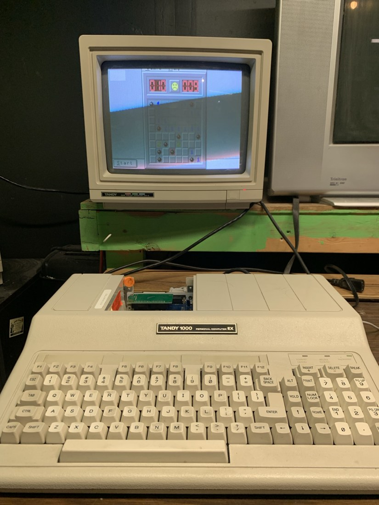

*Windows 3.1 Minesweeper on a real Tandy 1000 EX under Windows 3.0 (640 KB, NEC V20, lid
off to show the 3-in-1 upgrade card).*

| The TSR installing | The board | The game's own About box |
| --- | --- | --- |
| 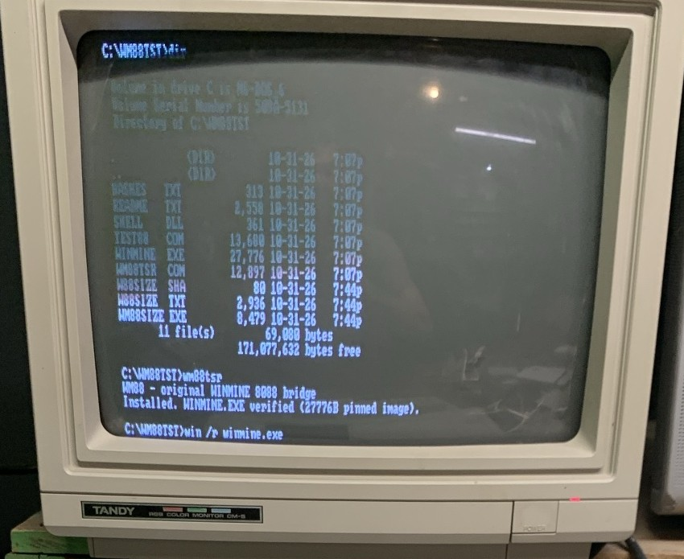 | 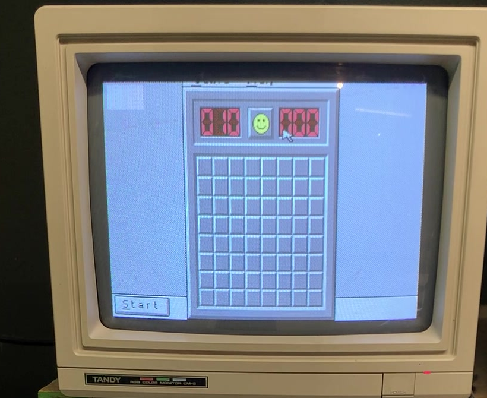 |  |

Video: <https://youtu.be/L1UxVt3oN9A>

## Screenshots

The Entertainment Packs on Tandy video, using the [Windows XT](https://github.com/astrobleem/oemdisplay-tandy)
display driver with its 640x256 panning desktop (HPXY). Each 640x256 image is assembled from
nine panned 320x200 views. These are emulator captures (DOSBox-X, Tandy 1000 machine, 8086
CPU setting), not photos of real hardware.

| | |
| --- | --- |
| 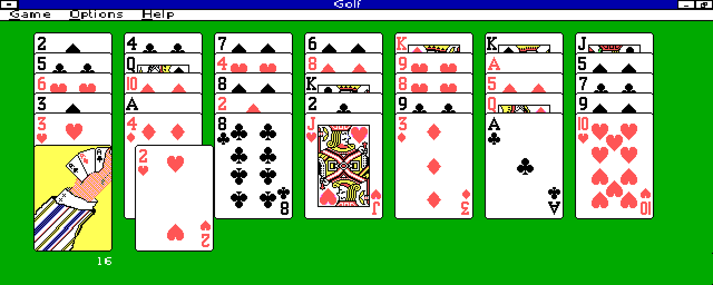 | 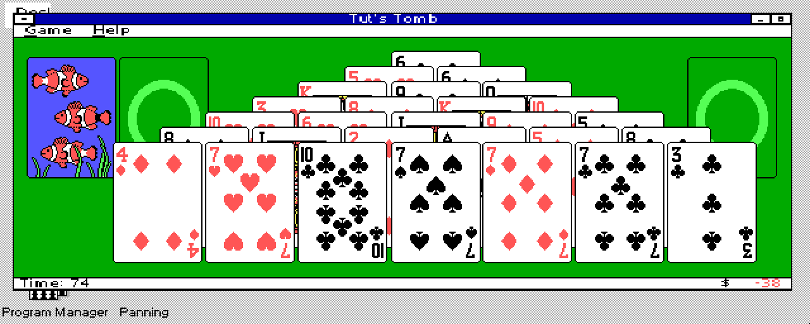 |
| Golf (Pack 1) | Tut's Tomb (Pack 2) |
| 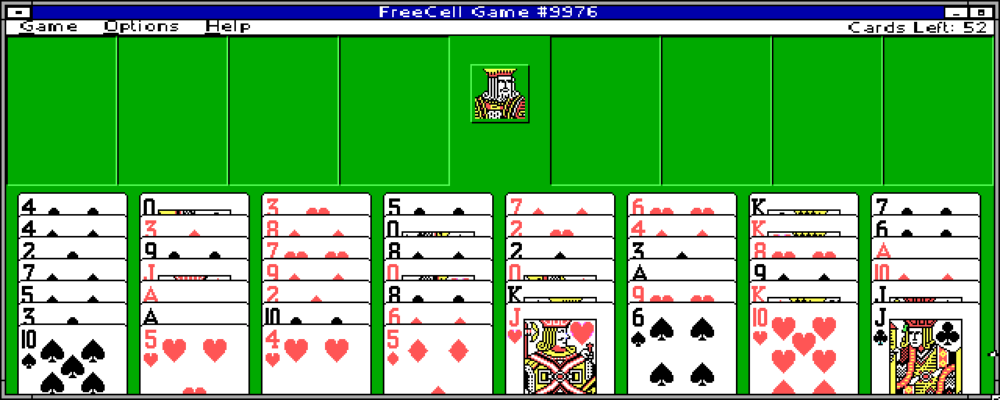 | 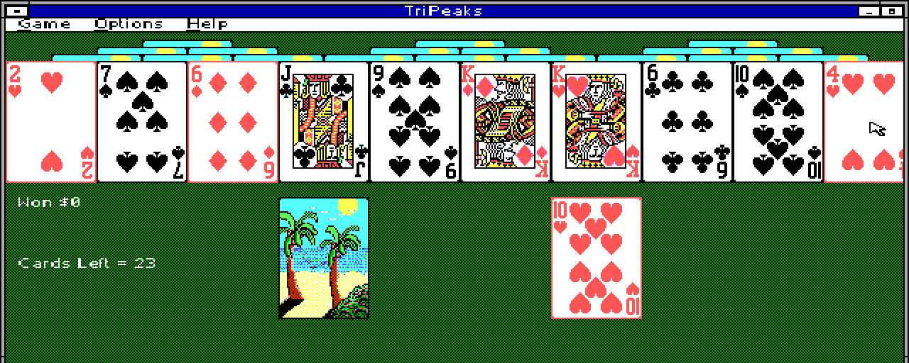 |
| FreeCell (Pack 2) | TriPeaks (Pack 3) |
| 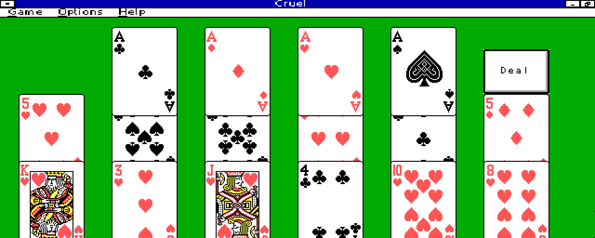 | 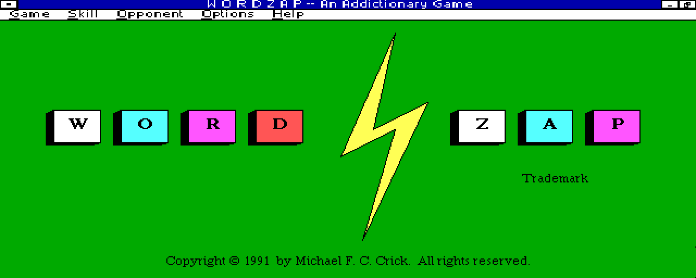 |
| Cruel (Pack 1) | WordZap (Pack 3) |
|  | 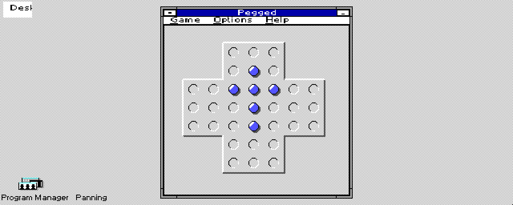 |
| Minesweeper, Windows 3.0 build (Pack 1) | Pegged (Pack 1) |

| | | |
| --- | --- | --- |
| 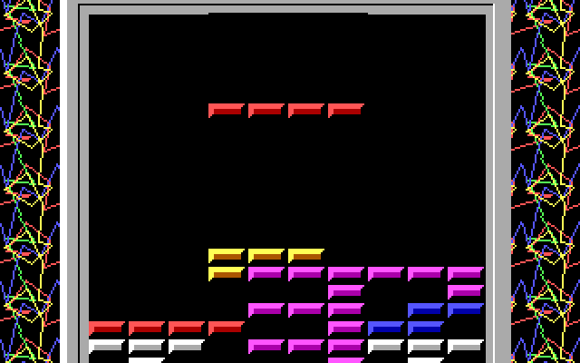 | 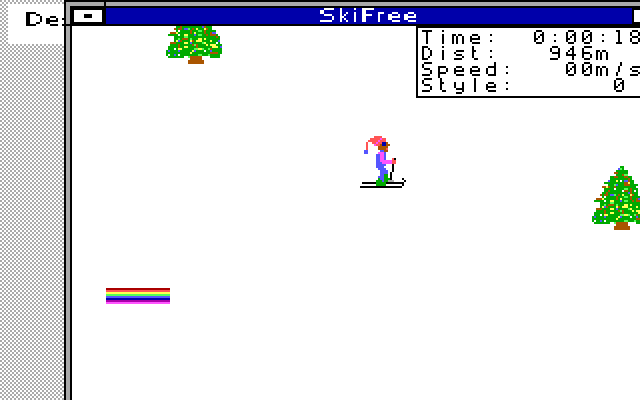 | 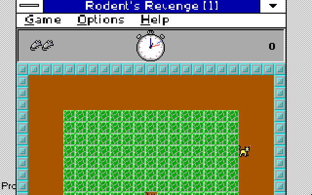 |
| Tetris (Pack 1), one 320x200 view | SkiFree (Pack 3), one 320x200 view | Rodent's Revenge (Pack 2, Visual Basic), fixed 320x200 driver |

Panning the view across the desktop in the driver's hardware-panning mode:
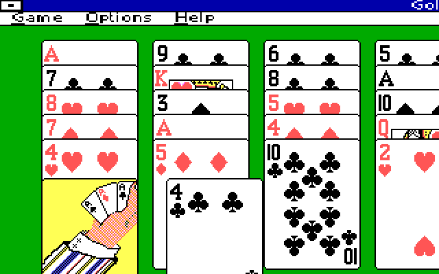

All the Tandy captures, the software-panning sweep, and what did not work on Tandy video are in
[docs/TANDY-COLOR-SCREENSHOTS.md](docs/TANDY-COLOR-SCREENSHOTS.md).
Some game boards (TetraVex, Pipe Dream, LifeGenesis) stay grey on any screen under 351
lines, by the games' own design.

## What works

| Software | Result | Where it was tested |
| --- | --- | --- |
| Windows 3.1 Minesweeper (original `WINMINE.EXE`) | Plays: reveal, flags, timer, win and loss | Real Tandy 1000 EX (NEC V20); cycle-accurate 8088 emulator; DOSBox-X; PCjs in the browser |
| Entertainment Packs 1-4 and *Best of* | 33 of 44 edition entries launch, take input and exit cleanly | MartyPC 8088 core ([results](docs/WEP-CLEAN-8088.md)) |
| Visual Basic 1.0 games: Jigsawed, RattleRace, Rodent's Revenge, Go Figure! | Play beside MS-DOS Executive and exit cleanly, with the converted VB runtime | MartyPC 8088 core ([results](docs/WEP-FOLLOWUP-VBRUN.md)) |
| Tic Tac Drop (Visual Basic) | Reaches its game window and menu with Hercules video | MartyPC 8088 and V20 cores |
| Chess, Chip's Challenge, Blackjack | Do not run yet | see [results](docs/WEP-CLEAN-8088.md) |

Only Minesweeper has been run on real hardware so far, and that machine has an NEC V20, which
executes 80186 instructions natively. A stock 8088 was tested in emulation only. "Plays" in the
emulator results means the inputs listed in each report, not full playthroughs.

## How it works

Windows 3.x programs fail on Windows 3.0 on an 8088 for a handful of reasons: the program
says it needs Windows 3.1, its code uses 80186 instructions (`PUSH imm`, `IMUL imm`, shifts
by an immediate, `ENTER`) that an 8088 does not have, it imports DLLs that Windows 3.0 lacks,
or its runtime assumes protected mode. 86TO88 handles each without touching the files on disk.

### WM88: Windows 3.1 Minesweeper

| Barrier in the original binary | What the bridge does |
| --- | --- |
| The NE header requires Windows 3.10 | The two version bytes are changed to 3.00 in the read buffer only |
| 449 sites use 80186 instructions | Rewritten in the buffer to `INT F8h` traps; a resident handler emulates each one exactly (result, flags, stack). 6 sites where a relocation overlaps the immediate use an `INT 3h` handler |
| Imports `SHELL.ShellAbout`; Windows 3.0 has no `SHELL.DLL` | A 361-byte `SHELL.DLL` built by the project exports that entry (it shows the app's own strings in a `MessageBox`) |
| `KERNEL`, `USER`, `GDI`, `SOUND` | Resolve to the genuine Windows 3.0 components; no Windows file is patched |

`WM88TSR.COM` translates `WINMINE.EXE` **in memory only**, as DOS reads it into the caller's
buffer. Before patching it checks the file's exact size and a CRC-32 of the whole file, tracks
handles by (handle, owning process) so a recycled handle never inherits the patch, and checks
the instruction bytes before emulating a trap, so code it does not own is never touched. The
two Windows 3.0 loader bugs that the shell DLL had to work around are in
[BUILD.md](BUILD.md#notes-on-the-rest-of-src).

### WM88X3: any game, from a module library

`tools/wep/` analyzes each game EXE and DLL and writes a small per-file **module** describing
its 80186 sites and the patches it needs. `WM88X3.COM` (about 3.3 KB resident) loads a module
when Windows opens the matching file, checks its name and size, and translates the code as it
is read. It detects an NEC V20/V30 at install and then leaves 80186 code running natively
(`/8` forces the 8088 rewriting, `/V` forces native). Details: [docs/WEP-LIBRARY.md](docs/WEP-LIBRARY.md).

### vbrun: the Visual Basic 1.0 runtime

`vbrun/` converts **your own copies** of `VBRUN100.DLL`, `FIELD100.DLL`, the Entertainment
Pack helper DLLs and the VB controls (`.VBX`) for Windows 3.0 real mode: 80186 rewriting,
return wrappers for code segments that move or are discarded, and trimming unused local heaps
so more memory is left for the game. It also builds a replacement `COMMDLG.DLL` (the Windows 3.1
common dialogs: Open, Save As, Color, Font, Print). The game EXEs are not modified.
Details: [vbrun/REPORT.md](vbrun/REPORT.md), [vbrun/NOTES.md](vbrun/NOTES.md).

## Display drivers

The stock Windows 3.0 `EGA.DRV` uses 80186 instructions and crashes a real 8088 before the
desktop appears ([docs/STOCK-8088.md](docs/STOCK-8088.md)). The stock CGA and Hercules drivers
work. For colour on 8088 machines, use 8088-safe drivers:

* [Windows XT for Tandy 1000](https://github.com/astrobleem/oemdisplay-tandy): 320x200 in 16
  colours, a 640x256 desktop with hardware or software panning, and more
* [EGA](https://github.com/astrobleem/windows-3-ega-8088) and [VGA](https://github.com/astrobleem/windows-3-vga-8088) for 8088 machines
* [PCjr](https://github.com/astrobleem/windows-3-pcjr), [Plantronics ColorPlus](https://github.com/astrobleem/windows-3-plantronics),
  [Amstrad PC1512](https://github.com/astrobleem/windows-3-amstrad-pc1512), [Olivetti PC1](https://github.com/astrobleem/windows-3-olivetti-pc1),
  [CGA](https://github.com/astrobleem/windows-3-cga), [Tandy Video II](https://github.com/astrobleem/windows-3-tandy-video-ii)

Memory is tight on a 640 KB machine. The Visual Basic games need the most; on Tandy video they
ran with the fixed 320x200 driver but not beside the 640x256 panning desktop.

## Try it

**In a browser:** <https://astrobleem.github.io/86TO88/>. Press **Download media & run**. Your
browser fetches public Windows 3.0/3.1 reference disks, checks every SHA-256, takes the original
`WINMINE.EXE` from the Windows 3.1 disk, and boots Windows 3.0 in real mode with the WM88 bridge.
The site hosts no Microsoft software and no ROMs. This is an emulated 80286 (PCjs), so it shows
the Windows 3.0 side, not the 8088 side.

**Minesweeper on a DOS machine:** you need DOS, Windows 3.0 and your own Windows 3.1
`WINMINE.EXE` (27,776 bytes, SHA-256 `633c1328…b15e80b`; other builds are refused).

1. Copy `deliverable/` to a floppy or a DOS directory and run `INSTALL.BAT`. It installs
   `SHELL.DLL` into `C:\WINDOWS\SYSTEM` (backing up any existing one) and the launcher into
   `C:\WINDOWS`.
2. Copy `WINMINE.EXE` into `C:\WINDOWS`, then `CD \WINDOWS` and run `WM88.BAT`.

**Entertainment Pack games:**

1. Build a module library from your own game files:
   `python3 tools/wep/w8lib.py auto LIB GAME.EXE ...` (run it in the game's directory).
2. Copy the library and `artifacts/WM88X3.COM` to the machine, and add `WM88X3 C:\W8X` (your
   library directory) to `AUTOEXEC.BAT` before Windows starts.
3. For Visual Basic games, build the converted runtime, controls and replacement COMMDLG from
   your own copies, and copy them into `WINDOWS\SYSTEM`:
   `VBW_ORIG=/path/to/originals ./vbrun/build.sh /path/to/output`.

## Building and testing

Everything is built from source in this repository with Python 3 (and NASM for the replacement
COMMDLG). See [BUILD.md](BUILD.md).

* `tests/` — DOS test suites for the WM88 instruction handler and read interception
* `tools/wep/unittest_*.py` — WM88X3 install, CPU detection, file reads from any directory,
  site emulation (Unicorn)
* `python3 -m pytest vbrun/tests` — the Visual Basic converter

## Documentation

| | |
| --- | --- |
| [WEP-CLEAN-8088.md](docs/WEP-CLEAN-8088.md) | All 44 Entertainment Pack entries on an emulated 8088 |
| [WEP-RESUMED-8088.md](docs/WEP-RESUMED-8088.md) | The eleven that did not pass, investigated |
| [WEP-FOLLOWUP-VBRUN.md](docs/WEP-FOLLOWUP-VBRUN.md) | Visual Basic games, Chess, replacement COMMDLG |
| [TANDY-COLOR-SCREENSHOTS.md](docs/TANDY-COLOR-SCREENSHOTS.md) | Tandy video: screenshots, panning, findings |
| [WEP-LIBRARY.md](docs/WEP-LIBRARY.md) | The WM88X3 analyzer, modules and loader |
| [WEP-COVERAGE.md](docs/WEP-COVERAGE.md) | Inventory of every title and edition |
| [STOCK-8088.md](docs/STOCK-8088.md) | Why stock Windows 3.0 crashes on an 8088 |
| [vbrun/REPORT.md](vbrun/REPORT.md) | The Visual Basic converter |
| [emulator/pcjs/README.md](emulator/pcjs/README.md), [site/README.md](site/README.md) | The browser demo |

## Credits

* **Muse Wonder (Meta)** built the original WM88 bridge: `WM88TSR.COM` and its instruction
  handler, the `SHELL.DLL` shim, the DOS test suites and their validation.
* **Claude (Anthropic)** built the WM88X3 analyzer and loader, the Visual Basic converter and
  replacement COMMDLG, the browser demo and the test rigs.
* Real-hardware testing: Chad Doebelin, on his Tandy 1000 EX.

## License

[MIT License](LICENSE), copyright 2026 Chad Doebelin. Windows, the Entertainment Packs and
Visual Basic are Microsoft products; this repository contains none of their files. Use media
you are entitled to use.

## Repository layout

* `deliverable/` — Minesweeper install bundle (TSR, shell DLL, installer, launcher)
* `src/` — assembler (`asm88.py`), TSR and DLL builders, site tables
* `artifacts/` — built TSRs and shim DLLs
* `tools/wep/` — Entertainment Pack analyzer, module library tool and tests
* `vbrun/` — Visual Basic 1.0 converter, replacement COMMDLG, MartyPC test rig
* `tests/` — DOS test suites
* `site/`, `emulator/` — browser demo and emulator configurations
* `docs/`, `evidence/` — reports, screenshots and test output
