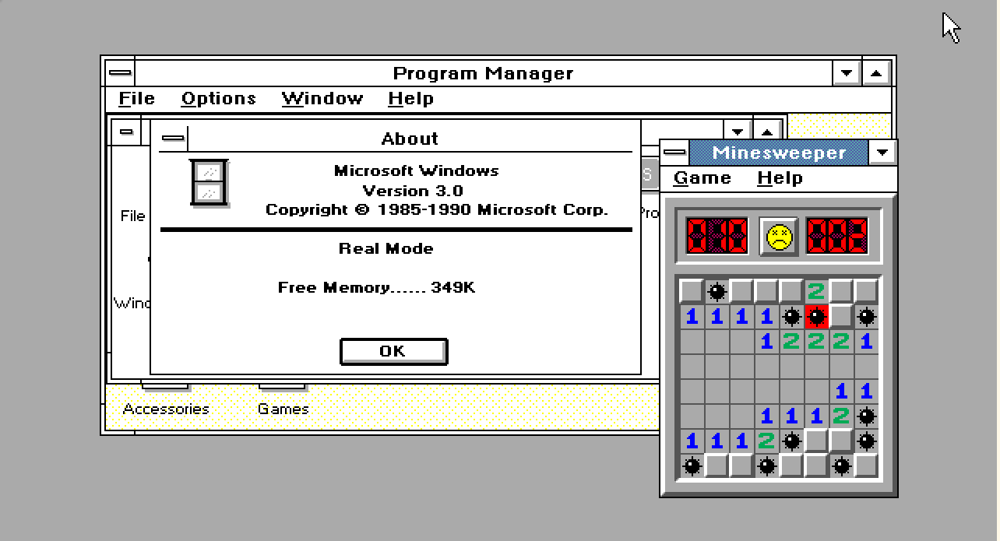
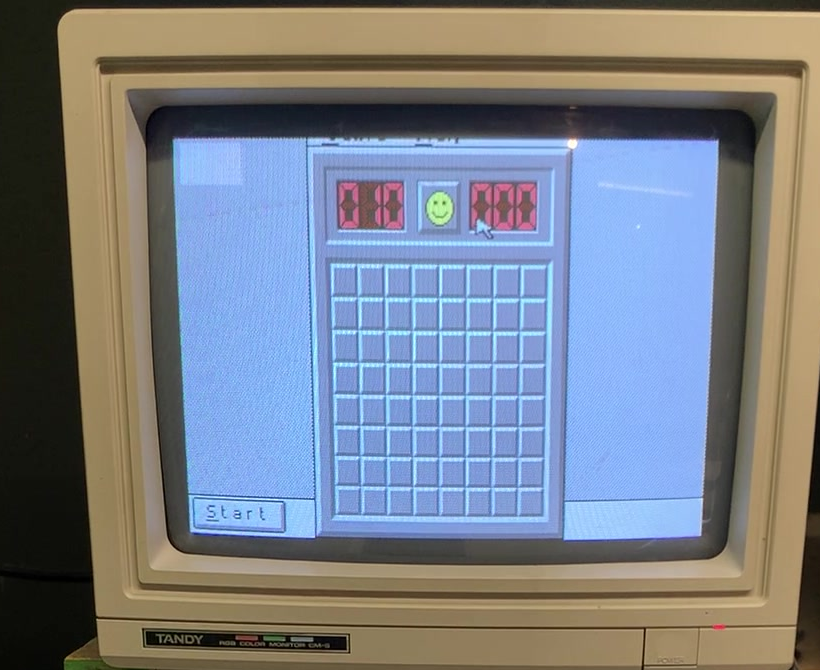
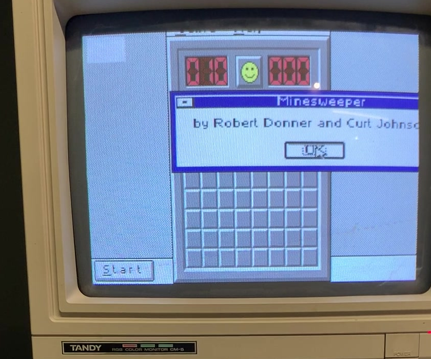
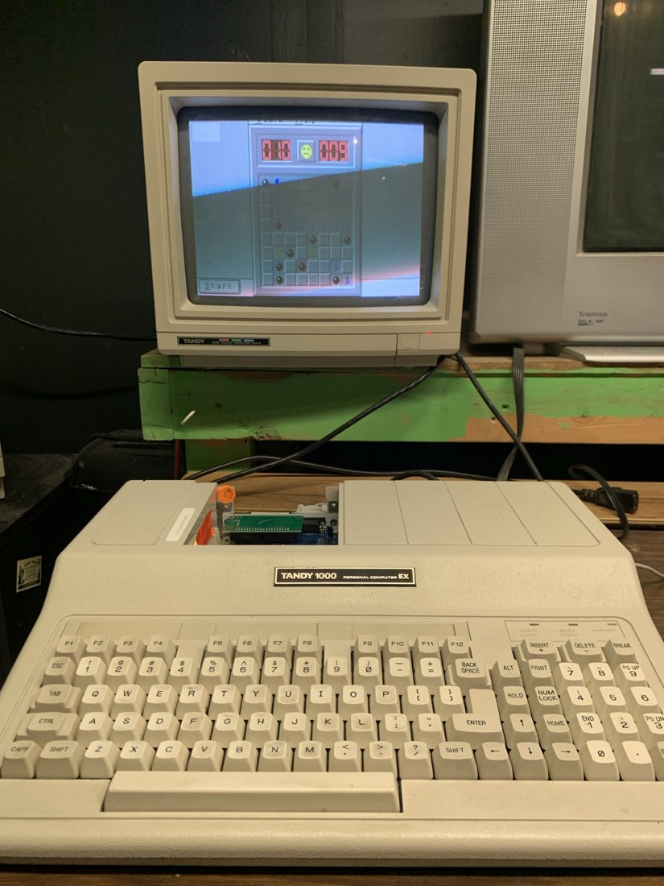
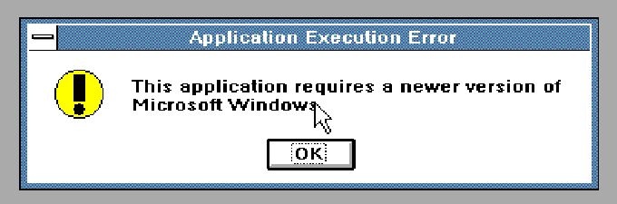
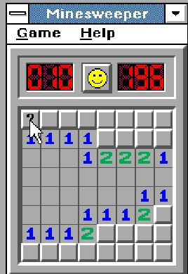
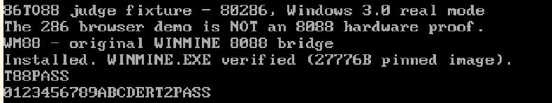
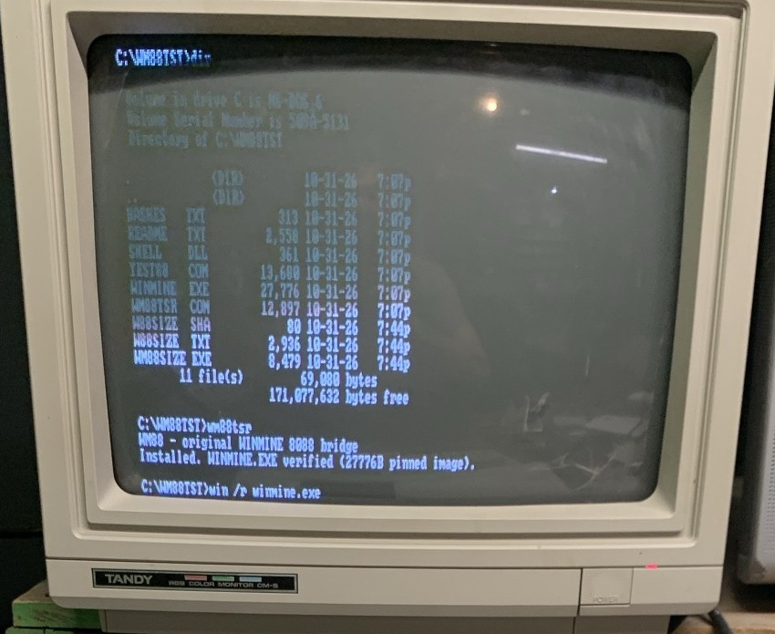

# 86TO88 — run the original Windows 3.1 Minesweeper on Windows 3.0 / 8088-class hardware

**86TO88** (the **WM88 bridge**) makes the *original, unmodified* Windows 3.1
`WINMINE.EXE` run and play under Windows 3.0 in real mode — the environment of
an 8088-based Tandy 1000 EX. It is a small DOS TSR plus a
361-byte DLL shim. No part of the game is reimplemented.

**It works on real hardware:** Chad reports running Windows 3.1 Minesweeper
on his Tandy 1000 EX under Windows 3.0. That hardware result is separate
from the emulator tests documented below.

**Video (under 3 minutes):** <https://youtu.be/L1UxVt3oN9A>

Submission for the Meta Global AI Developer Hackathon. The bridge was built by
Meta's **Muse Wonder** model; see [How this was built](#how-this-was-built).

## Try it

**1. In your browser, one click: <https://astrobleem.github.io/86TO88/>**

Open the page in a desktop browser and press **Download media & run**. Your
browser fetches the hash-pinned public reference disks and ROMs, checks every
SHA-256, pulls the original `WINMINE.EXE` out of the Windows 3.1 disk
(exactly 27,776 bytes, hash-checked), builds the guest disk in memory and boots
**Windows 3.0 in real mode** with the WM88 bridge. About 10 MB is downloaded.
This site hosts **no Microsoft software and no ROMs**; if any check fails, the
page stops and Windows is not launched. Steer the guest's mouse arrow to a
square, left-click to reveal, right-click to flag, F2 for a new game.

**This is an emulated 80286 (PCjs), not an 8088.** It proves the original game
runs under Windows 3.0 real mode through the bridge; the Tandy 1000 EX result
is separate evidence.



*Captured from the hosted page: Windows 3.0 **Real Mode** (About box), the
original Windows 3.1 Minesweeper beside Program Manager, driven by the WM88 bridge.*

**2. On real hardware.** Chad runs the original Windows 3.1 Minesweeper on a
Tandy 1000 EX (CPU: NEC V20, an 8088-compatible chip that also executes 80186 instructions; expanded to 640 KB, with a 3-in-1 serial / CompactFlash / memory
upgrade card, run with the lid off so the upgrade is visible) under Windows 3.0. Frames from his phone video of the
EX's own screen (Tandy CM-5 monitor), cropped and otherwise unedited:

| The board | The game's own About box |
| --- | --- |
|  |  |

The machine itself, with the lid off so the memory / 3-in-1 upgrade card is visible:



The right edge of the About box is clipped by the display.

**What the Tandy run does and does not show.** The EX in these photos has an NEC V20 in
place of the stock 8088. The V20 is pin-compatible but executes the 80186 instructions
(`PUSH imm`, `IMUL imm`, shifts by an immediate) natively, so on this machine the
missing-instruction barrier does not exist. The TSR does not detect the CPU and still
rewrites those sites to `INT F8h`, so the handler ran on real hardware, but the game
would not have faulted without it. The run does show the version-stamp change, the
`SHELL.DLL` shim and the TSR working on a real machine under Windows 3.0 real mode.
**It is not a test on a physical stock 8088.** The stock-8088 result comes from a
cycle-accurate 8088 emulator; see [Stock 8088](#stock-8088).
The explainer video is in the submission.

**3. Locally, from a clone** (Python 3.9+, internet access):

```sh
python3 tools/prepare_pcjs.py --reference-media --out ../86to88-private-judge
python3 -m http.server 8080 --bind 127.0.0.1 --directory ../86to88-private-judge
```

Open **<http://127.0.0.1:8080/judge.html>**. On Windows, use `py -3` or
`python` instead of `python3`. Ctrl+C stops the server. This builds the same
fixture as the hosted page, from the same pinned media, on your machine.

**Or with Docker** (serves the same page locally):

```sh
docker build -t 86to88 .
docker run --rm -p 8080:80 86to88
```

Then open <http://localhost:8080/>. The image holds no Microsoft files; the page
downloads the pinned public media in your browser, exactly as the hosted site does.

Chrome boot, gameplay, loss and restart were tested. Firefox and Safari are
untested; fullscreen is optional and complete wins through the hosted page
remain unverified. DOS/Windows/ROM media is not in this repo and must not be
published; use media you are entitled to use. See
[setup, provenance and validation limits](emulator/pcjs/README.md) and
[the hosted site's design](site/README.md).

> **The original `WINMINE.EXE` stays byte-for-byte unchanged on disk.** The
> TSR intercepts DOS file reads of that one file and translates the bytes
> **in memory only** (in the caller's read buffer). The disk file is never
> written, and segments that Windows discards and reloads are simply
> re-translated on the next read.

## Why the 3.1 binary won't start on Windows 3.0, and what the bridge does

| Without the bridge (PCjs, 286) | Running with the bridge (PCjs, 286) |
|---|---|
|  |  |

**Installing the TSR: emulator vs. real hardware.** Same step, same message: the TSR
reports `Installed. WINMINE.EXE verified (27776B pinned image)`, then Windows starts.

| Emulator (PCjs, 286) | Real Tandy 1000 EX (NEC V20) |
| --- | --- |
|  |  |

The hardware photo shows the directory listing (`WINMINE.EXE` 27,776 bytes, `WM88TSR.COM`
12,897 bytes), `wm88tsr` installing, and `win /r winmine.exe` about to start Windows in
real mode. That `WM88TSR.COM` is the hardened build used for the hardware run, so its size
differs from the published 12,316-byte binary the emulator uses. See the
[evidence section](#status--real-hardware-and-emulator-evidence) for the separation between runs.

Earlier evidence remains available: [86Box refusal](evidence/win30-winmine-refusal.png),
[DOSBox-X solved board](evidence/finalD-wonboard.png), and
[TSR installation in 86Box](evidence/wm88-tsr-installed.png).

| Barrier in the stock binary | Bridge fix (all outside the file) |
|---|---|
| NE header says "requires Windows 3.10" | The two version bytes are flipped 3.10 → 3.00 in the read buffer only |
| 449 sites use 80186+ instructions (`PUSH imm`, `IMUL imm`, `SHL/SHR/SAR reg,imm8`) that fault on an 8088 | Sites are rewritten in the buffer to `INT F8h` traps; a resident handler emulates each instruction exactly (result, flags, stack). 6 further sites where a relocation overlaps a push immediate use an `INT 3h` handler |
| Imports `ShellAbout` from module `SHELL` ordinal 22; Windows 3.0 has no `SHELL.DLL` | We ship a 361-byte `SHELL.DLL` exporting exactly that entry (it forwards the app's own strings to `MessageBox`) plus `WEP` |
| Everything else (`KERNEL`, `USER`, `GDI`, `SOUND` imports) | Resolves to genuine Windows 3.0 components — module `SOUND` is provided by the stock `SOUND.DRV`. **No Windows file is patched, hooked, or replaced** |

Safety: before tracking any handle, the TSR verifies the opened file in
full — exact size (27,776 bytes) and a CRC-32 of the entire contents — so a
foreign file that merely shares the name `WINMINE.EXE` is never patched.
Tracked handles are keyed by (handle, owning PSP) and purged when the
owning process exits, because DOS closes a dead process's files internally
and recycles the handle number; a recycled handle can therefore never
inherit the patch. The `INT 3h` handler verifies the surrounding
instruction bytes in memory before emulating a site, and the `INT F8h`
lookup is range-checked: traps from unrelated code are chained to the
previous handler or counted as errors, never mis-emulated. An
unrecognized binary is left completely alone.

## Getting from a translated binary to a running game

The project is about carrying the original game across two boundaries at
once: Windows 3.1 to Windows 3.0, and 80186+ instructions to an 8088.
Changing the minimum Windows version alone cannot solve either the CPU
instructions or the missing shell import. The bridge handles those three
obstacles while leaving the game logic and Windows 3.0 APIs in place.

The small shell shim also had to be a DLL that the real Windows 3.0 loader
could accept. Two loader bugs made that distinction concrete:

* The far-call relocation chain needed a `0xFFFF` terminator. A zero word
  made KERNEL follow code bytes as further links and loop during loading.
* An empty NE resource table needed four bytes: a shift-count word and a
  terminating type word. A two-byte table let KERNEL interpret the following
  name table as resource metadata, corrupting its heap and hanging the load.

Those discoveries remain in [the shim builder](src/build_shell.py) and
[the build notes](BUILD.md#notes-on-the-rest-of-src). They are part of why
this is more than an instruction-patching exercise: the original loader,
DLL imports, relocation records, and discardable segments all still have
to work together. The later handle and trap-ownership fixes described above
keep that translation confined to the intended specimen.

## What you supply

* DOS + **Windows 3.0** running in real mode (`WIN /R`).
* **Your own unmodified `WINMINE.EXE`** from Windows 3.1. Reference
  specimen used in development:
  27,776 bytes, SHA-256
  `633c1328922b4092351e0019b1ba1c6d56c0f0fea83824cc8b7e2e731b15e80b`.
  A different build will (correctly) be refused by the TSR.

## Quick start

**Real DOS machine**

1. Copy `deliverable/` to a floppy or DOS directory.
2. Run `INSTALL.BAT` there — it installs `SHELL.DLL` into `C:\WINDOWS\SYSTEM`
   (backing up any existing one) and the launcher into `C:\WINDOWS`.
3. Copy your `WINMINE.EXE` into `C:\WINDOWS`.
4. `CD \WINDOWS`, run `WM88.BAT`, play.

**DOSBox-X fixture**

Put a Windows 3.0 installation plus the copies above into one folder, point
`deliverable/dosbox-wm88.conf`'s mount at it, and run
`dosbox-x -conf dosbox-wm88.conf`. Windows boots with the game already open.

## Status — real hardware and emulator evidence

### Real hardware

Chad reports that Windows 3.1 Minesweeper worked on his physical **Tandy
1000 EX under Windows 3.0**. That machine has an NEC V20 (8088-compatible, with
the 80186 instruction set) in place of the stock 8088, so this run does not test
the missing-instruction fix on a CPU that lacks those instructions. The stock-8088
case was run on a cycle-accurate 8088 emulator instead; see
[Stock 8088](#stock-8088) below.

### Recorded gameplay and safety checks

Proven end-to-end in the recorded emulator sessions (see `evidence/`): the
original binary launches, and gameplay works — first-click flood reveal, numbers, flag/question-mark
cycling with the mine counter, the 1 Hz timer, F2 / Game→New restart,
preference persistence to `WINMINE.INI`, a logically solved **win** (best-time
dialog, `Time1=801` recorded by the game itself), and a **loss** with all ten
mines exposed. DOS-level suites (`tests/TEST88.COM`, `tests/RTEST2.COM`)
verify the instruction emulation (flags/stack/registers) and the read
interception (partial/overlapping reads, seeks, EOF) exactly; the
handle-safety suite (`tests/LEAK.COM`, `CHECK.COM`, `FCHECK.COM`) and the
trap-ownership probes (`tests/T88B.COM`) verify that recycled handles,
same-named foreign files, and colliding trap offsets in unrelated code are
never patched or emulated. Those four review findings were reproduced
against the original TSR and are fixed in the current build
(`WM88TSR.COM` SHA-256 `c04950d3…`, 12,316 bytes); the fixed TSR was then
re-run through the full Windows gameplay regression (window opens, flag
plants with the counter decrementing, numbered reveal with the timer
running — see `evidence/fixed-tsr-*.png`).

### Stock 8088

A stock Windows 3.0 install crashes on a real 8088 because its own EGA display driver
(`EGA.DRV`) uses 80186 instructions, which an 8088 silently mis-executes. That is what
stopped the earlier PCjs and 86Box runs, not the bridge. On a cycle-accurate 8088
emulator (MartyPC), Windows 3.0 with the CGA driver and the WM88 bridge runs the original
`WINMINE.EXE`; the Tandy driver (TANDY88) was audited and contains no 80186 instructions.
The EGA and VGA drivers shipped with Windows 3.0 are not safe on a stock 8088.

Real vs simulated: all of Windows and 100% of the game logic are the genuine
original code. The single simulated piece is `ShellAbout`: instead of the
richer 3.1 About box you get a plain `MessageBox` with the app's name and
"by Robert Donner and Curt Johnson". No game API is stubbed.

Performance (DOSBox-X, 10,000 fixed cycles): DOS boot → playable window in
about 2.3 s. This is a historical emulator measurement, not a Tandy benchmark;
physical hardware performance has not been measured in the available report.
The TSR is 12,316 bytes on disk, ≈11 KB resident.

## How this was built

- **Muse Wonder (Meta)** built the core bridge: the `WM88TSR.COM` TSR and its instruction
  handler, the 361-byte `SHELL.DLL` shim, the DOS test suites and the original validation.
  It started from a prompt that described the problem and pointed to where the public
  Windows 3.0 and Windows 3.1 disk images could be found.
- **Claude (Anthropic)** later built the hosted GitHub Pages site (`site/`), the explainer
  video and the README and evidence write-up, working on top of Muse Wonder's output. It did
  not write the bridge logic.
- The hardware run used a hardened derivative of the published TSR; see
  [Status](#status--real-hardware-and-emulator-evidence) for what each run does and does not prove.

## License

[MIT License](LICENSE), copyright 2026 Chad Doebelin.

## Repository layout

* `deliverable/` — the consumer bundle (TSR, shim, installer, launcher, fixture config)
* `src/` — all builder/analysis source, including the two-pass 8086 assembler (`asm88.py`), the site generator (`gen_sites.py`), and the TSR/shim builders
* `artifacts/` — generated patch/site tables the builders embed, plus export maps used during analysis
* `tests/` — prebuilt DOS verification suites
* `tools/` — host-side test tooling (serial-mouse server, board reader)
* `emulator/` — the scripted-test DOSBox-X configuration (serial mouse)
* `evidence/` — curated screenshots and test outputs from the runs described above

See `BUILD.md` to rebuild everything from source.

Built for the Meta Global AI Developer Hackathon engineering-agent brief.
Development model: Muse (muse-wonder-1.0) — all reverse engineering,
implementation, testing, and gameplay.
