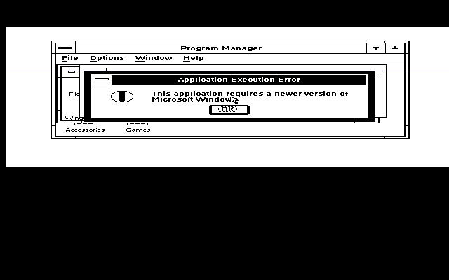
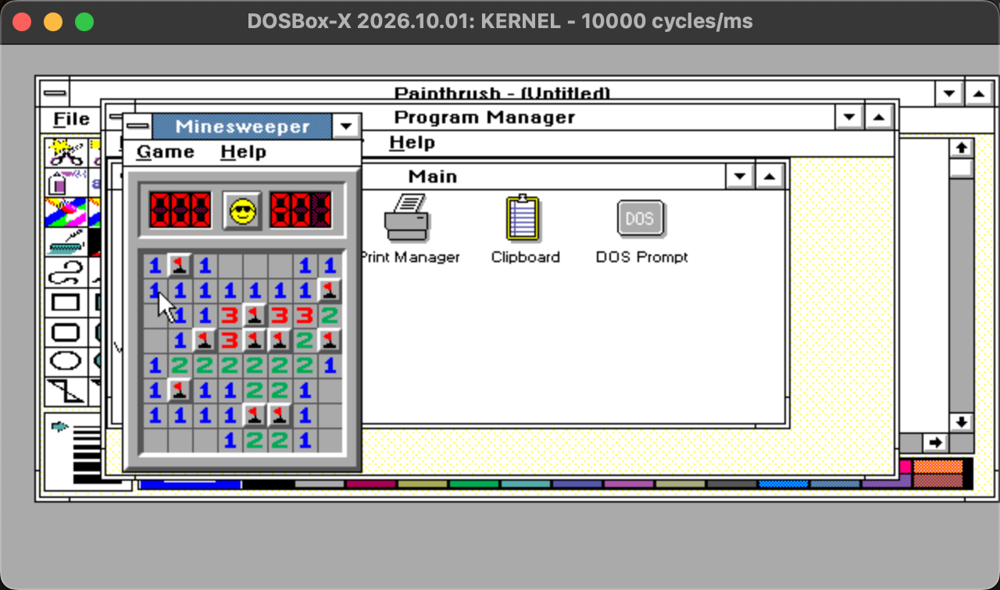
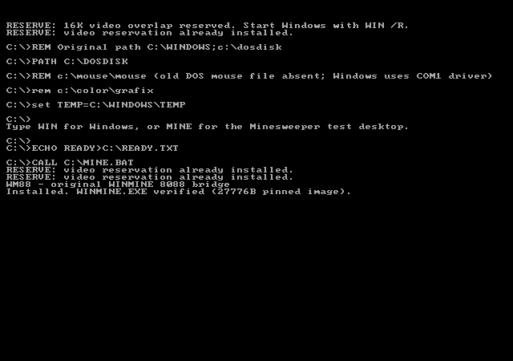

# 86TO88 — run the original Windows 3.1 Minesweeper on Windows 3.0 / 8088-class hardware

**86TO88** (the **WM88 bridge**) makes the *original, unmodified* Windows 3.1
`WINMINE.EXE` run and play under Windows 3.0 in real mode — the environment of
an 8088-based Tandy 1000 EX. It is a small DOS TSR plus a
361-byte DLL shim. No part of the game is reimplemented.

**It works on real hardware:** Chad reports running Windows 3.1 Minesweeper
on his Tandy 1000 EX under Windows 3.0. That hardware result is separate
from the emulator tests documented below.

> **The original `WINMINE.EXE` stays byte-for-byte unchanged on disk.** The
> TSR intercepts DOS file reads of that one file and translates the bytes
> **in memory only** (in the caller's read buffer). The disk file is never
> written, and segments that Windows discards and reloads are simply
> re-translated on the next read.

## Why the 3.1 binary won't start on Windows 3.0, and what the bridge does

| Without the bridge (86Box) | Running with the bridge (DOSBox-X, 286) |
|---|---|
|  |  |

*Loading the TSR in 86Box, from an earlier test build.*

| Barrier in the stock binary | Bridge fix (all outside the file) |
|---|---|
| NE header says "requires Windows 3.10" | The two version bytes are flipped 3.10 → 3.00 in the read buffer only |
| 449 sites use 80186+ instructions (`PUSH imm`, `IMUL imm`, `SHL/SHR/SAR reg,imm8`) that fault on an 8088 | Sites are rewritten in the buffer to `INT F8h` traps; a resident handler emulates each instruction exactly (result, flags, stack). 6 further sites where a relocation overlaps a push immediate use an `INT 3h` handler |
| Imports `ShellAbout` from module `SHELL` ordinal 22; Windows 3.0 has no `SHELL.DLL` | We ship a 361-byte `SHELL.DLL` exporting exactly that entry (it forwards the app's own strings to `MessageBox`) plus `WEP` |
| Everything else (`KERNEL`, `USER`, `GDI`, `SOUND` imports) | Resolves to genuine Windows 3.0 components — module `SOUND` is provided by the stock `SOUND.DRV`. **No Windows file is patched, hooked, or replaced** |

Safety: before tracking any handle, the TSR verifies the opened file in
full — exact size (27,776 bytes) and a CRC-32 of the entire contents — so a
foreign file that merely shares the name `WINMINE.EXE` is never patched.
Tracked handles are keyed by (handle, owning PSP) and purged when the
owning process exits, because DOS closes a dead process's files internally
and recycles the handle number; a recycled handle can therefore never
inherit the patch. The `INT 3h` handler verifies the surrounding
instruction bytes in memory before emulating a site, and the `INT F8h`
lookup is range-checked: traps from unrelated code are chained to the
previous handler or counted as errors, never mis-emulated. An
unrecognized binary is left completely alone.

## Getting from a translated binary to a running game

The project is about carrying the original game across two boundaries at
once: Windows 3.1 to Windows 3.0, and 80186+ instructions to an 8088.
Changing the minimum Windows version alone cannot solve either the CPU
instructions or the missing shell import. The bridge handles those three
obstacles while leaving the game logic and Windows 3.0 APIs in place.

The small shell shim also had to be a DLL that the real Windows 3.0 loader
could accept. Two loader bugs made that distinction concrete:

* The far-call relocation chain needed a `0xFFFF` terminator. A zero word
  made KERNEL follow code bytes as further links and loop during loading.
* An empty NE resource table needed four bytes: a shift-count word and a
  terminating type word. A two-byte table let KERNEL interpret the following
  name table as resource metadata, corrupting its heap and hanging the load.

Those discoveries remain in [the shim builder](src/build_shell.py) and
[the build notes](BUILD.md#notes-on-the-rest-of-src). They are part of why
this is more than an instruction-patching exercise: the original loader,
DLL imports, relocation records, and discardable segments all still have
to work together. The later handle and trap-ownership fixes described above
keep that translation confined to the intended specimen.

## What you supply

* DOS + **Windows 3.0** running in real mode (`WIN /R`).
* **Your own unmodified `WINMINE.EXE`** from Windows 3.1. Reference
  specimen used in development:
  27,776 bytes, SHA-256
  `633c1328922b4092351e0019b1ba1c6d56c0f0fea83824cc8b7e2e731b15e80b`.
  A different build will (correctly) be refused by the TSR.

## Quick start

**Real DOS machine**

1. Copy `deliverable/` to a floppy or DOS directory.
2. Run `INSTALL.BAT` there — it installs `SHELL.DLL` into `C:\WINDOWS\SYSTEM`
   (backing up any existing one) and the launcher into `C:\WINDOWS`.
3. Copy your `WINMINE.EXE` into `C:\WINDOWS`.
4. `CD \WINDOWS`, run `WM88.BAT`, play.

**DOSBox-X fixture**

Put a Windows 3.0 installation plus the copies above into one folder, point
`deliverable/dosbox-wm88.conf`'s mount at it, and run
`dosbox-x -conf dosbox-wm88.conf`. Windows boots with the game already open.

## Status — real hardware and emulator evidence

### Real hardware

Chad reports that Windows 3.1 Minesweeper worked on his physical **Tandy
1000 EX under Windows 3.0**. Real-hardware operation is therefore no longer
an outstanding milestone.

### Recorded gameplay and safety checks

Proven end-to-end in the recorded emulator sessions (see `evidence/`): the
original binary launches, and gameplay works — first-click flood reveal, numbers, flag/question-mark
cycling with the mine counter, the 1 Hz timer, F2 / Game→New restart,
preference persistence to `WINMINE.INI`, a logically solved **win** (best-time
dialog, `Time1=801` recorded by the game itself), and a **loss** with all ten
mines exposed. DOS-level suites (`tests/TEST88.COM`, `tests/RTEST2.COM`)
verify the instruction emulation (flags/stack/registers) and the read
interception (partial/overlapping reads, seeks, EOF) exactly; the
handle-safety suite (`tests/LEAK.COM`, `CHECK.COM`, `FCHECK.COM`) and the
trap-ownership probes (`tests/T88B.COM`) verify that recycled handles,
same-named foreign files, and colliding trap offsets in unrelated code are
never patched or emulated. Those four review findings were reproduced
against the original TSR and are fixed in the current build
(`WM88TSR.COM` SHA-256 `c04950d3…`, 12,316 bytes); the fixed TSR was then
re-run through the full Windows gameplay regression (window opens, flag
plants with the counter decrementing, numbered reveal with the timer
running — see `evidence/fixed-tsr-*.png`).

### The 8088 emulator startup investigation

The full Windows gameplay sessions above used **DOSBox-X with an emulated
286** (`cputype=286`). The project's earlier investigation found that its
8086 core also hung a stock Windows 3.0 installation. Passing DOS-level
instruction tests and starting Windows are separate checks; the former
alone did not establish that the complete game worked on a physical 8088.
Chad's hardware report now supplies the real-machine result.

The earlier investigation also compared two independent emulators:

* **PCjs** — the earlier README records an XT configuration with the same
  BIOS, chipset, and hard disk, changing only the CPU model. Its 80286 model
  reached Program Manager; its 8088 model failed in real-mode KERNEL startup
  while loading the display driver. The `pcjs-xt286cpu-*.png` screenshots
  named in that account are not present in this repository, so this remains
  a historical finding rather than an inspectable capture here.
* **86Box** — the recorded XT/8088 configuration (`ibmxt86`, 4.77 MHz, EGA)
  showed the Windows splash and then a black-screen hang. The earlier
  investigation reports no disk I/O, a spinning host CPU, and disabled
  interrupts, after checking keyboard type, DOS `CONFIG.SYS` drivers, and
  mouse presence. The same disk image on an XT Model 286 (80286, 6 MHz)
  reached Program Manager. Both endpoint captures are retained:
  [8088 black screen](evidence/emu86-8088-blackhang.png) and
  [286 Program Manager](evidence/emu86-xt286-progman.png).

These comparisons pointed toward emulator CPU/startup behavior in those
configurations. They do not establish a universal limitation of current
PCjs or 86Box versions, and they do not contradict the physical Tandy
result. The useful distinction is between a stock Windows startup problem
in those emulator runs and the bridge's translation and gameplay checks.

Real vs simulated: all of Windows and 100% of the game logic are the genuine
original code. The single simulated piece is `ShellAbout`: instead of the
richer 3.1 About box you get a plain `MessageBox` with the app's name and
"by Robert Donner and Curt Johnson". No game API is stubbed.

Performance (DOSBox-X, 10,000 fixed cycles): DOS boot → playable window in
about 2.3 s. This is a historical emulator measurement, not a Tandy benchmark;
physical hardware performance has not been measured in the available report.
The TSR is 12,316 bytes on disk, ≈11 KB resident.

## License

[MIT License](LICENSE), copyright 2026 Chad Doebelin.

## Repository layout

* `deliverable/` — the consumer bundle (TSR, shim, installer, launcher, fixture config)
* `src/` — all builder/analysis source, including the two-pass 8086 assembler (`asm88.py`), the site generator (`gen_sites.py`), and the TSR/shim builders
* `artifacts/` — generated patch/site tables the builders embed, plus export maps used during analysis
* `tests/` — prebuilt DOS verification suites
* `tools/` — host-side test tooling (serial-mouse server, board reader)
* `emulator/` — the scripted-test DOSBox-X configuration (serial mouse)
* `evidence/` — curated screenshots and test outputs from the runs described above

See `BUILD.md` to rebuild everything from source.

Built for the Meta Global AI Developer Hackathon engineering-agent brief.
Development model: Muse (muse-wonder-1.0) — all reverse engineering,
implementation, testing, and gameplay.
