# Entertainment Pack games in colour on Tandy video (Windows XT drivers)

New screenshots of the titles with earlier launch evidence, taken with the
[Windows XT](https://github.com/astrobleem/oemdisplay-tandy) Tandy display drivers instead of
CGA/Hercules. **Emulator only. No real hardware was tested, and no game was played through.**
These runs are DOSBox-X, not MartyPC: MartyPC needs a Tandy BIOS ROM to emulate a Tandy 1000,
and none was available here.

## Setup

* **Emulator:** DOSBox-X 2024.03.01, `machine=tandy`, `cputype=8086_prefetch`, 640 KB,
  `cycles=fixed 20000`, serial mouse on COM1. The disk's own PC DOS 3.20 is booted (`boot -l c`),
  then Windows 3.0 real mode from the project's test disk.
* **Drivers:** WXTF1107.ZIP from the `windows-xt` release, installed as Windows Setup and
  `DISPWIN` would install them: the driver, XTC/XTE fonts and `TANDYGR.GR2` in `SYSTEM`,
  `SYSTEM.INI [boot]`, `WIN.COM` rebuilt from `WIN.CNF` + `XTSTATIC.LGO` + `WXTSPL01.RLE`, and on
  every boot `RESERVE`, `FIXXT GRABBER`, `FIXXT PANINIT`, `WIN /R game.exe`. So TGCLIP and PAN load
  with Windows, beside Program Manager.
  * **HPXY.DRV** (640x256 desktop through a 320x200, 16-colour view) for most games.
  * **TANDY88.DRV** (fixed 320x200, 16 colours) where HPXY ran out of memory (below).
* **Game files:** Packs 1 and 3 (1991 3.5" editions, expanded with the pack's `EXPAND.EXE`) use
  the original helper DLLs with `WM88X3.COM` and a per-pack module library, as in
  [WEP-LIBRARY.md](WEP-LIBRARY.md). Packs 2 and 4 use the converted runtime from
  `wip/vbrun100-realmode` 13fd86d (VBRUN100, FIELD100, WEPUTIL, WEP4UTIL, CMDIALOG/GAUGE/THREED,
  replacement COMMDLG), no TSR.
* **Does DOSBox-X's 8086 setting behave like an 8088 here?** For the case checked, yes: with the
  bridge not patching (next section), TetraVex fails with the same WEPUTIL message in DOSBox-X
  `8086_prefetch`, in plain `8086`, and on MartyPC's 8088 core, and runs with DOSBox-X `80186`.
  That is one data point, not a qualification of DOSBox-X's 8086 core.
* The driving scripts are not included; they are tied to this environment's paths.

## How the 640x256 images were made

The screen shows a 320x200 view of the 640x256 desktop. Each full-desktop image is assembled
from nine real views, panned with PAN's Ctrl+Alt+arrow keys (8x4-pixel steps) to origins
x = 0, 160, 320 and y = 0, 28, 56, then scaled 2x. Two things stay at a fixed place in every view
and appear once in the assembled image: the minimized PAN window (top left, shows "Desk") and
the mouse pointer (parked at the bottom right). Every pixel where two views overlap was compared;
the assembled images below have no differences except a running clock (TetraVex, Tut's Tomb)
and one 12x10-pixel spot in TriPeaks.
For games that keep moving (Tetris, SkiFree, Pipe Dream, IdleWild), a single 320x200 view is
shown instead, because the views would not have matched.

## HPXY, 640x256 desktop (assembled from nine views)

| | |
| --- | --- |
| Cruel (Pack 1) 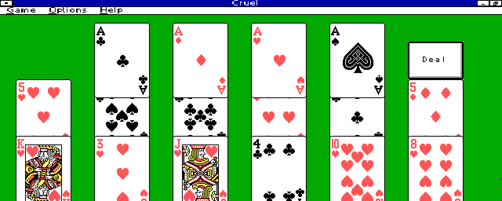 | Golf (Pack 1) 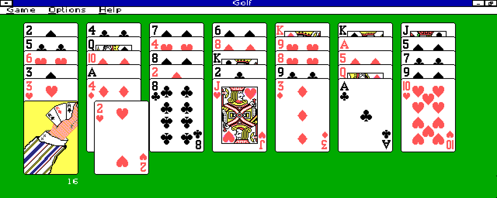 |
| Pegged (Pack 1) 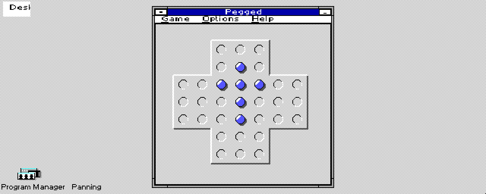 | TicTactics (Pack 1) 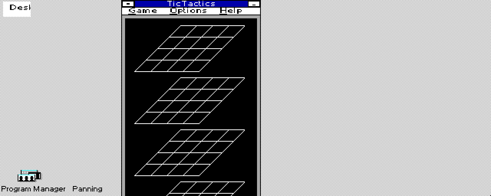 |
| Minesweeper, Windows 3.0 build (Pack 1) 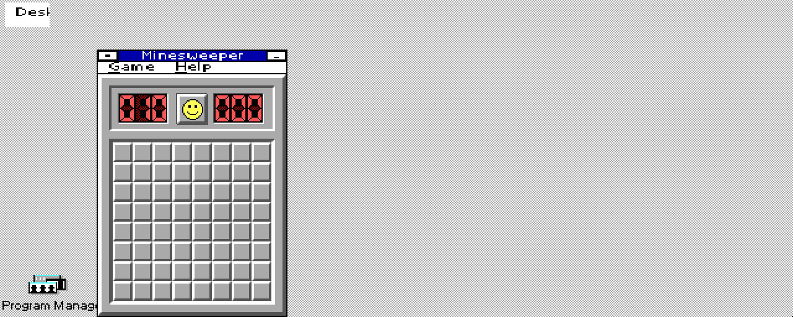 | Taipei splash (Pack 1) 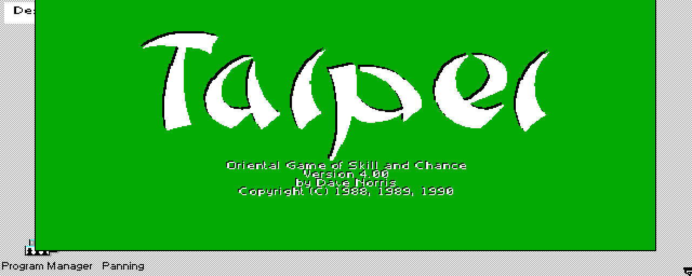 |
| Tetris About box (Pack 1) 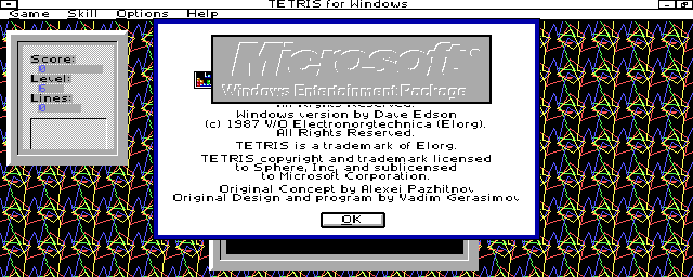 | FreeCell (Pack 2) 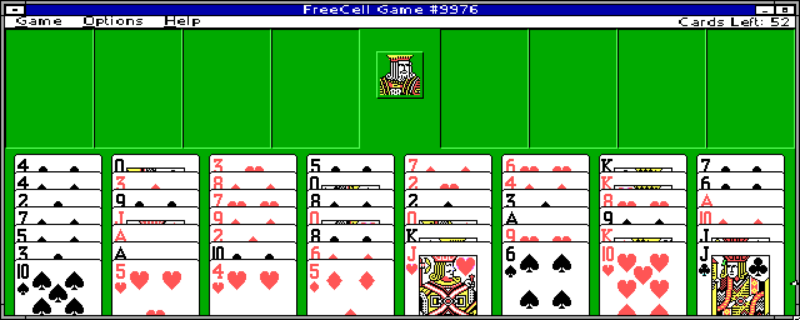 |
| Tut's Tomb (Pack 2) 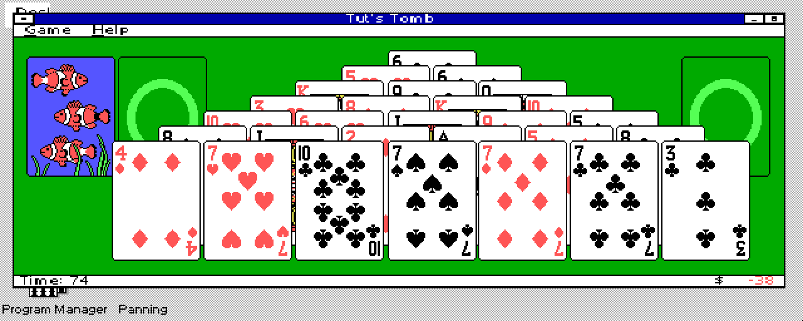 | TetraVex (Pack 3) 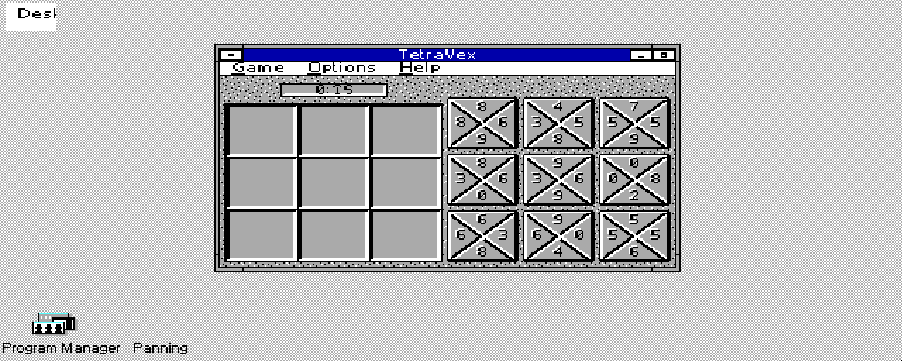 |
| TriPeaks (Pack 3) 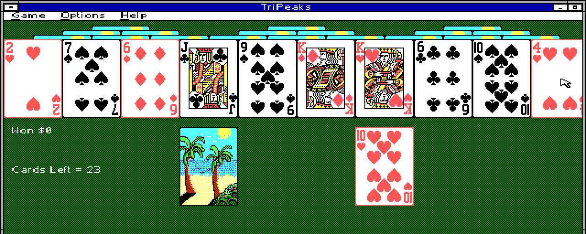 | WordZap (Pack 3) 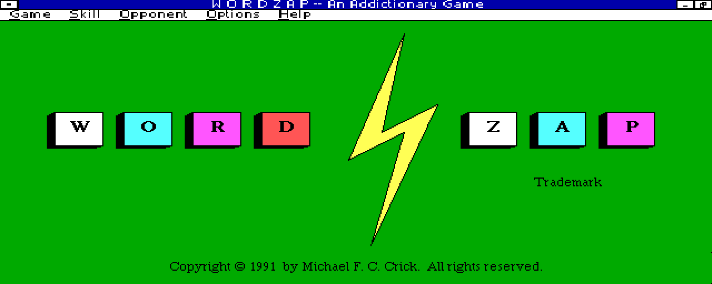 |
| Klotski (Pack 3) 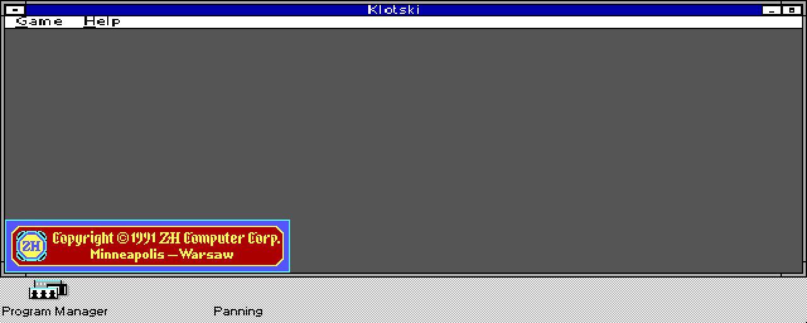 | LifeGenesis (Pack 3) 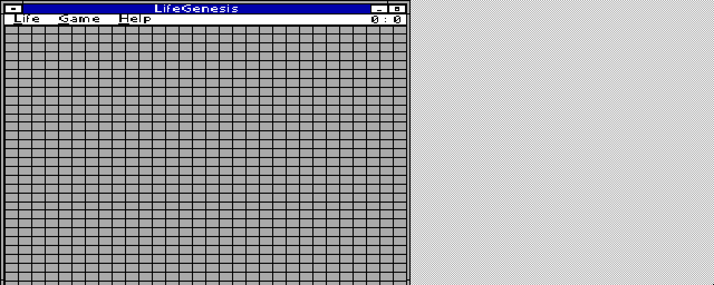 |

The Tetris About box is the older four-view assembly; its window covers the whole desktop.

## HPXY, single 320x200 views (moving games)

| | |
| --- | --- |
| Tetris in play (Pack 1) 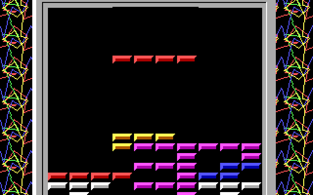 | SkiFree (Pack 3) 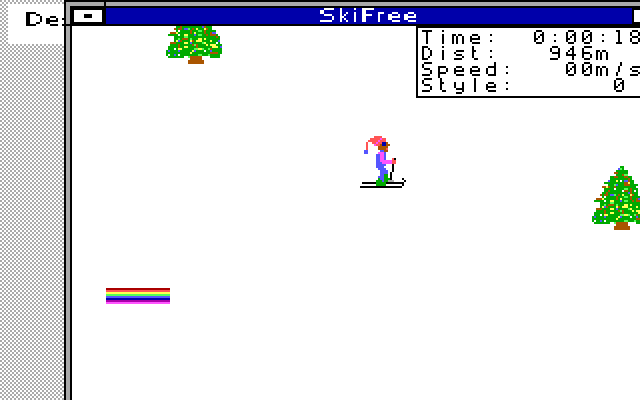 |
| Pipe Dream, F2 (Pack 2) 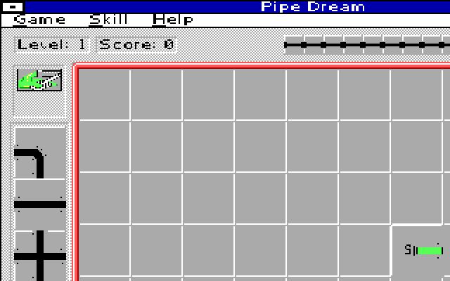 | IdleWild (Pack 1) 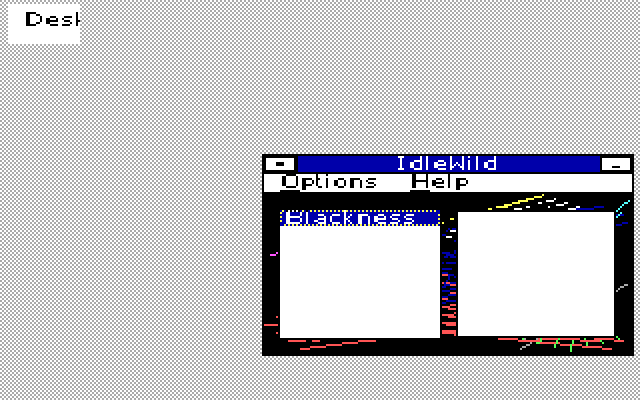 |

## TANDY88, fixed 320x200

| | |
| --- | --- |
| Jigsawed About box (Pack 2, VB) 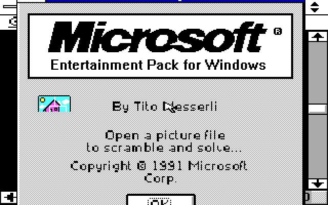 | RattleRace title (Pack 2, VB) 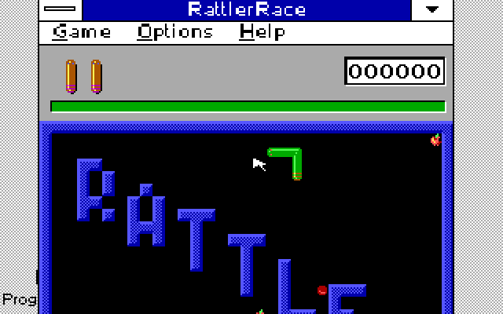 |
| Rodent's Revenge (Pack 2, VB) 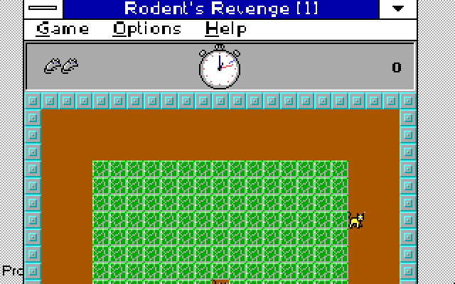 | Go Figure! after F2 (Pack 4, VB) 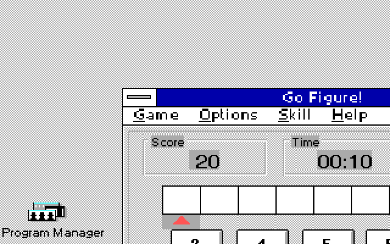 |
| JezzBall (Pack 4) 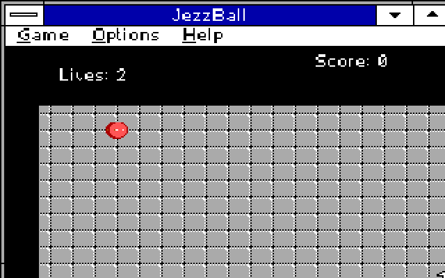 | |

These windows are larger than 320x200; only their top-left part is on screen.

## Hardware and software panning

PAN's status window reports the mode (`SW` / `HW`); the choice is made in PAN's settings
(Ctrl+Alt+S) and was switched there with the keyboard.

| software (default) | settings: Hardware applied | hardware |
| --- | --- | --- |
|  | 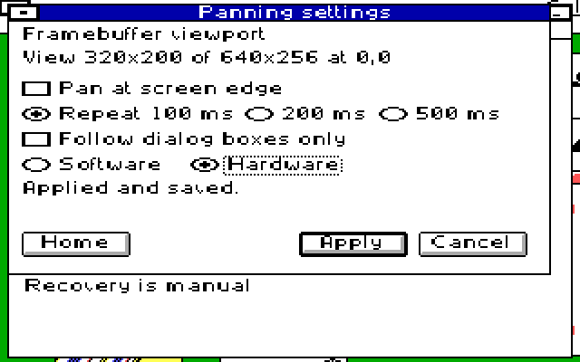 | 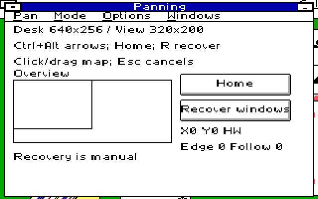 |

Sweeps of the view across the whole desktop, one frame per Ctrl+Alt+arrow step (Golf):
[hardware](../evidence/tandy/golf-pan-hw.gif), [software](../evidence/tandy/golf-pan-sw.gif)
(in the software sweep Program Manager had come to the front). Both modes showed the same picture
in DOSBox-X; this says nothing about how either looks or performs on a real EX/HX.

## Findings

1. **Many WEP game boards stay grey on purpose.** WEPUTIL's start-up code
   (`GetSystemMetrics(SM_CYSCREEN)`, compare with 351) turns its colour flag off on any screen
   under 351 lines and loads its monochrome bitmap instead of the colour one; 256 and 200 lines
   are both under the limit. TetraVex's tiles, Pipe Dream's board and LifeGenesis's grid are
   grey here; that these games take their colours from that flag is likely but was not traced
   game by game. The card games and the games with their own palettes (Cruel, Golf, FreeCell,
   Tut's Tomb, TriPeaks, WordZap, SkiFree, Tetris, Rodent's Revenge) are in full colour.
   Changing the threshold in the converted WEPUTIL would be the way to try colour boards; not done.
2. **WM88X3 does not patch games in short directories.** `build_lpath` in
   `src/build_tsr3.py` copies the file name using the length of the *directory part* as its
   count, so the module name is cut short when the directory path is shorter than the 8.3 name
   plus two (for example `C:\GAME\TETRAVEX.EXE`). The game then runs unpatched; TetraVex shows
   "Please obtain a newer version of WepUtil.DLL". Seen in DOSBox-X and on MartyPC's 8088 core,
   and reproduced in `unittest_io3.py` by changing its directory: `C:\GAME\` 625 unpatched bytes,
   `C:\WEPGAMES\` and `C:\WINDOWS\` none. The tests always use `C:\WINDOWS\`, which is long
   enough. Games here were put in `C:\WEPGAMES`. Fixed afterwards in PR #5 (merged into `main`
   as 6cb05ef); TetraVex then runs from `C:\GAME` on MartyPC's 8088 core and in DOSBox-X.
3. **VB games and memory with HPXY.** With HPXY and PAN/TGCLIP loaded: RattleRace stopped the
   emulated machine (DOSBox-X printed "IBM ROM BASIC NOT IMPLEMENTED", i.e. INT 18h was reached);
   Jigsawed showed an empty message box in one run and stopped the machine the same way in a
   second ([screen](../evidence/tandy/jigsawed-hpxy-crash.png)); Rodent's Revenge got
   "System Error / Terminating current application"; Go Figure! never showed a window; Pack 4
   JezzBall reported "There Is Not Enough Memory" and Fuji Golf "Not enough memory". The four
   VB games and JezzBall start with TANDY88. The same Jigsawed disk with the stock CGA driver
   reaches its About box in DOSBox-X, so the crash belongs to this combination; the cause was not
   traced.
4. **Did not start on either Tandy driver:** Fuji Golf ("Not enough memory", also with TANDY88
   and with MS-DOS Executive as shell and no TGCLIP/PAN;
   [screen](../evidence/tandy/fujigolf-tandy320-not-enough-memory.png)); Tic Tac Drop with
   TANDY88 beside Program Manager stops with "Property or control 'Label2' not found", the
   memory-starvation error seen before ([screen](../evidence/tandy/tictacdrop-tandy320-label2.png)).
   One Tic Tac Drop run with MS-DOS Executive and no TGCLIP/PAN left a blank text screen while
   DOSBox-X wrote gigabytes of log; it was stopped and not investigated.
5. **Taipei** shows its splash and then its window closes (the earlier WM88X3 result was also
   splash only). **Klotski** shows its window and copyright box after its welcome dialog, but no
   puzzle was drawn.
6. **PAN after minimizing:** the minimized Panning window's icon follows the view to its top-left
   corner and shows the start of its "Desk 640x256" text. It is visible in every view.

## Not covered

No real Tandy hardware. No MartyPC Tandy machine. No Best of editions. Stones, Blackjack, Chips,
Chess and Maxwell's Maniac were not tried. Pack 1 Golf and Tetris, untested in the coverage
matrix, are shown here (Golf dealt; Tetris started with F2 and left running on HPXY).
